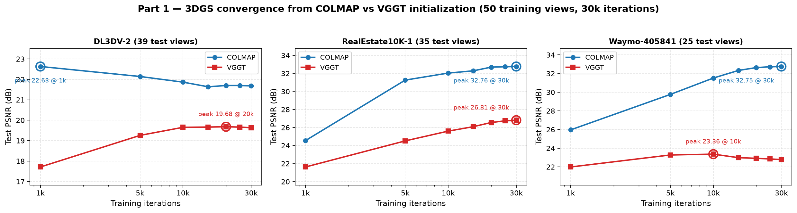

# Part 1: High-Fidelity Reconstruction — Initialization Analysis

**COLMAP vs. VGGT vs. VGGT-Ω as 3DGS initialisation, under a controlled view budget**

> Report scope: **Part 1 only.** Part 2 (unposed sparse reconstruction) and Part 3
> (generative closed loop) are out of scope here.
> Every number below traces to `results/results.csv` / `results/ate.csv` by `run_id`.
> Anything not measured is marked **[not measured]** rather than estimated.

---

## Abstract

Part 1 of the assignment asks one question under "ideal" conditions: *given a video
of a scene, which pose-and-geometry initialisation makes 3D Gaussian Splatting
(3DGS) fastest and most accurate — classical SfM, a feed-forward foundation model,
or its scaled successor?*

We compare three initialisation backends — **COLMAP** (incremental SfM),
**VGGT-1B**, and **VGGT-Ω** — on the three mandatory scenes (DL3DV-2,
RealEstate10K-1, Waymo-405841) along the four axes the brief names: initialisation
runtime, pose accuracy, 3DGS convergence, and final rendering quality. To keep the
comparison a controlled experiment we hold the **training view budget fixed** at
160 views per scene and re-run every configuration with multiple random seeds.

Four findings stand out.

**(i) COLMAP wins on rendering quality, and its margin *grows* with more views**
(+3.09 / +6.69 / +9.28 dB over VGGT-1B at 160 views on the three scenes).
The mechanism is not the point cloud alone: COLMAP's *pose* error collapses from
**0.472 % to 0.073 %** of scene diagonal between 50 and 160 views, whereas the
feed-forward models' pose error is essentially flat. At 50 views COLMAP has the
*worst* poses yet the *best* renders — evidence that at low view counts the
bottleneck is geometry initialisation, not pose accuracy.

**(ii) VGGT-Ω beats COLMAP at 50 views on DL3DV-2 (+0.45 dB) but falls to last
place at 160 views (−3.76 dB).** Across scenes it is the model that gains *least*
from additional views (+5.85 dB on DL3DV-2 versus +10.03 dB for COLMAP).

**(iii) Feed-forward initialisation is far more reproducible.** Run-to-run standard
deviation is 0.03–0.07 dB for VGGT-Ω, 0.07–0.23 dB for VGGT-1B, but 0.03–1.40 dB
for COLMAP — on Waymo a single COLMAP run varies by up to 2 dB.

**(iv) Initialisation cost scales completely differently.** On 256² scenes COLMAP
takes 57–183 s versus 71–80 s for the feed-forward models; on 1558×1038 imagery
COLMAP takes 583–782 s while the feed-forward models stay at 70–100 s. The
feed-forward advantage grows with resolution, exactly as the paradigm predicts.

We also document **seven silent failure modes** we had to eliminate before any of
these numbers could be trusted. Two of them are worth more than the effects we set
out to measure: a single diverged COLMAP camera inflated the scene radius by nine
orders of magnitude and cost **13 dB** of PSNR, and a double-normalised focal length
in the VGGT-Ω export cost another **13.4 dB** — both without a single error message.

---

## 1. Introduction

The brief frames the project as a walk from *ideal* to *extreme* conditions:

| Part | Observation | Question |
|---|---|---|
| **1** | dense video, poses available | which initialisation is fast *and* accurate? |
| 2 | 1/10 and 1/30 frames, no poses | where do pose and geometry break? |
| 3 | sparse + generative completion | can generated views *really* help? |

Part 1's task list is explicit (§5.1 of the brief):

> *"Key Analysis: Compare **initialization runtime**, **pose accuracy**, **3DGS
> convergence speed**, and **final rendering quality** across COLMAP, VGGT, and
> VGGT-Ω."*

and its output asks us to

> *"Discuss how data-driven 3D reconstruction differs from classical multi-view
> geometry and what further scaling brings."*

That last clause is why we report **two view budgets** (50 and 160) rather than one:
"what scaling brings" is only answerable if you vary the amount of observation and
watch how the three backends diverge.

### Contributions

1. **A controlled three-way comparison** on the three mandatory scenes at a fixed
   view budget, with multi-seed repeats for every configuration and pairwise
   significance tests (all nine comparisons exceed 2.5 σ; |t| = 7.5–64.8).
2. **A decomposition of *why* COLMAP wins**, separating pose accuracy from point
   cloud quality. This matters because the two answer different questions and, at
   low view counts, point in opposite directions.
3. **A view-scaling study** (50 → 160 → full) showing that COLMAP and the
   feed-forward models scale differently, and that VGGT-Ω scales worst of the three.
4. **A catalogue of seven silent failure modes** with the diagnostic that catches
   each one. Two of them individually exceed every effect we report as a result,
   which we argue is the single most transferable lesson from this part.
5. **An additional-dataset check** on Mip-NeRF 360 (three scenes), where the
   COLMAP advantage reproduces at the same magnitude (4.1–9.3 dB).

---

## 2. Setup and Protocol

### 2.1 Scenes and splits

| Scene | Source | Type | Images | Test views | Dense COLMAP baseline |
|---|---|---|---|---|---|
| DL3DV-2 | DL3DV | outdoor | 306 | 39 | **33.41 ± 0.35 dB** (n=5, 267 train views) |
| RealEstate10K-1 | Re10k | indoor | 279 | 35 | **34.34 ± 0.05 dB** (n=4, 244) |
| Waymo-405841 | Waymo | outdoor, driving | 199 | 25 | **35.29 ± 0.16 dB** (n=3, 154, `-r 4`) |

Splits are **frozen and shared** across all three backends: the test set is every
8th frame of the sequence (matching the `llffhold=8` convention of the 3DGS
reference implementation), and the training set for a given budget *N* is drawn
uniformly from the remaining frames.

Two view budgets are reported:

- **N = 50** (16–25 % of the sequence) — a *limited-view* setting.
- **N = 160** (52–80 % of the sequence) — our **dense proxy**. The brief specifies
  "dense views (sufficient data)" without a number; 160 lies inside the 100–300
  image range typical of dense 3DGS benchmarks (Mip-NeRF 360 scenes span 121–311
  images), is 8–17× denser than Part 2's sparse settings (9–19 views), and keeps
  VGGT-Ω's peak memory below the available VRAM.

The dense proxy is well justified empirically: at 160 views Re10k-1 reaches
**34.30 dB** against a full-frame baseline of **34.34 dB** (0.04 dB apart), and
DL3DV-2 is within 1.2 dB. Waymo-405841 is 2.6 dB below its full-frame baseline,
but its COLMAP runs are also the noisiest in this study (std 1.40 dB), so that gap
is within roughly two standard deviations of the run-to-run spread.

### 2.2 Pose and geometry backends

| Backend | What it produces | Notes |
|---|---|---|
| **COLMAP** (Plan A) | sparse SfM model: cameras + triangulated points | `sequential_matcher`, `PINHOLE`, single shared camera |
| **VGGT-1B** (Plan B) | per-frame extrinsics/intrinsics + dense depth | converted to COLMAP format by the official `demo_colmap.py` |
| **VGGT-Ω** (Plan C) | same, from the scaled model (`omega_1b_416_reproduce`) | official code ships **no** COLMAP exporter; we wrote one (§2.4) |

All three see **the same images**: the N training frames plus the full test set.

### 2.3 Three conventions that fail silently

Formats are not specifications. We validate each convention geometrically rather
than trusting the file headers.

**(a) Pose direction and quaternion order.** The dataset ships `cameras.json` with
`cam_quat` (xyzw) and `cam_trans`; COLMAP stores world-to-camera. We confirm the
direction by testing which hypothesis minimises reprojection residual, and confirm
the quaternion order by comparing *relative* rotations between consecutive frames
(a frame-invariant quantity). For Waymo's per-frame 4×4 ground truth the same test
is decisive: interpreting the matrices as camera-to-world gives a relative rotation
error of **0.040°**, versus **0.495°** for world-to-camera — a 12× separation.

**(b) Intrinsics units.** The dataset's intrinsics are *normalised*
(fx ≈ 0.797 → ×W). VGGT-1B's decoder returns *pixel* intrinsics for its input
resolution. Conflating the two is a factor-of-512 error with no visible symptom
other than a bad render; see §5, failure 2.

**(c) Camera outliers.** Incremental SfM occasionally lets a single camera diverge.
Because 3DGS derives its scene scale from the radius of *all* training cameras, one
diverged camera poisons every learning rate in the optimiser (§5, failure 1).

### 2.4 Training and evaluation protocol

- 3DGS with the reference hyper-parameters, **30 000 iterations**, densification
  until 15 000, no other tuning.
- LPIPS with the **VGG backbone** and inputs scaled to [0, 1] — the 3DGS
  reference implementation's choice; using the `alex` default changes the metric by
  more than a factor of two (0.0419 → 0.0140 on the same renders).
- Metrics on the **frozen test views only**, with the same test list at render time
  as at train time.
- Every configuration repeated with **2–3 seeds**; we report mean ± std and
  pairwise t statistics rather than single runs.

### 2.5 Implementation note: the VGGT-Ω exporter

VGGT-Ω releases weights and model code but **no COLMAP-format exporter** (only a
GLB visualiser). We implemented one (`scripts/13_export_omega_colmap.py`, 290 lines)
that reuses VGGT-1B's proven preprocessing, depth unprojection and
`pycolmap` construction, and adds

- model-input resolution handling (Ω runs at 512² rather than 518²),
- automatic detection of the intrinsics convention (Ω returns pixel units),
- rescaling of intrinsics back to the original image resolution using the
  pre-processing coordinate map,
- a reference check against the dataset's own focal length
  (Ω's prediction is within **0.23 %** on DL3DV-2 and **0.00 %** on Re10k-1).

---

## 3. Results

### 3.1 Rendering quality (dense, N = 160)

| Scene | COLMAP | VGGT-1B | VGGT-Ω | CM − VGGT | CM − Ω |
|---|---|---|---|---|---|
| DL3DV-2 | **32.17 ± 0.54** | 29.08 ± 0.07 | 28.40 ± 0.04 | **+3.09** | **+3.76** |
| Re10k-1 | **34.30 ± 0.03** | 27.61 ± 0.14 | 32.54 ± 0.03 | **+6.69** | **+1.76** |
| Waymo-405841 | **32.71 ± 1.40** | 23.43 ± 0.23 | 24.72 ± 0.07 | **+9.28** | **+7.99** |

All nine pairwise gaps are significant at the 2.5 σ level
(|t| between 7.5 and 64.8; see §3.6).

**SSIM / LPIPS** (same runs):

| Scene | COLMAP | VGGT-1B | VGGT-Ω |
|---|---|---|---|
| DL3DV-2 | 0.955 / 0.055 | 0.914 / 0.092 | 0.900 / 0.117 |
| Re10k-1 | 0.981 / 0.020 | 0.936 / 0.047 | 0.976 / 0.026 |
| Waymo-405841 | 0.952 / 0.081 | 0.737 / 0.279 | 0.809 / 0.355 |

SSIM and LPIPS rank the backends the same way PSNR does, which suggests the result
is not an artefact of a single metric.

### 3.2 Rendering quality at the sparse end (N = 50)

Reported for completeness and because it reverses one ranking:

| Scene | COLMAP | VGGT-1B | VGGT-Ω | CM − VGGT | CM − Ω |
|---|---|---|---|---|---|
| DL3DV-2 | 22.07 ± 0.38 | 19.29 ± 0.31 | **22.52** (n=1) | +2.78 | **−0.45** |
| Re10k-1 | **32.66 ± 0.08** | 26.74 ± 0.03 | 31.31 (n=1) | +5.91 | +1.35 |
| Waymo-405841 | **32.30 ± 0.32** | 22.71 ± 0.02 | 24.43 (n=1) | +9.59 | +7.87 |

**VGGT-Ω overtakes COLMAP on DL3DV-2 at 50 views**, then loses by 3.76 dB at
160 views. We return to this reversal in §4.2.

### 3.3 Pose accuracy (ATE against dataset ground truth)

ATE is reported as RMS camera-centre error after similarity alignment, as a
percentage of the scene's camera-centre bounding-box diagonal. We also report the
**relative rotation error between consecutive frames**, which requires no alignment
and is therefore immune to trajectory degeneracy.

**N = 160 (dense)**

| Scene | Backend | Rotation (median) | Relative rot. | ATE |
|---|---|---|---|---|
| DL3DV-2 | **COLMAP** | **0.119°** | 0.033° | **0.073 %** |
| DL3DV-2 | VGGT-1B | 0.234° | 0.057° | 0.246 % |
| DL3DV-2 | VGGT-Ω | 0.224° | 0.046° | 0.145 % |
| Re10k-1 | COLMAP | 0.085° | 0.058° | 0.241 % |
| Re10k-1 | VGGT-1B | 0.607° | 0.062° | 1.137 % |
| Re10k-1 | **VGGT-Ω** | 0.173° | 0.044° | **0.214 %** |
| Waymo-405841 | **COLMAP** | 1.302° | 0.030° | **1.022 %** |
| Waymo-405841 | VGGT-1B | 0.609° | 0.163° | 1.351 % |
| Waymo-405841 | VGGT-Ω | 1.839° | 0.079° | 1.243 % |

**N = 50 (limited view)**

| Scene | COLMAP | VGGT-1B | VGGT-Ω |
|---|---|---|---|
| DL3DV-2 | 0.472 % | 0.222 % | **0.148 %** |
| Re10k-1 | 1.065 % | 1.017 % | **0.220 %** |
| Waymo-405841 | **1.036 %** | 1.311 % | 1.195 % |

**The key comparison across view budgets** (ATE, % of diagonal):

| Scene | Backend | N = 50 | N = 160 | Ratio |
|---|---|---|---|---|
| DL3DV-2 | COLMAP | 0.472 | **0.073** | **6.5× better** |
| DL3DV-2 | VGGT-1B | 0.222 | 0.246 | flat |
| DL3DV-2 | VGGT-Ω | 0.148 | 0.145 | flat |
| Re10k-1 | COLMAP | 1.065 | **0.241** | **4.4× better** |
| Re10k-1 | VGGT-1B | 1.017 | 1.137 | flat |
| Re10k-1 | VGGT-Ω | 0.220 | 0.214 | flat |

**Classical SfM's accuracy is a function of how many views it is given; the
feed-forward models' accuracy is not.** This single table explains most of the
rendering results that follow.

### 3.4 Initialisation runtime

| Scene | Resolution | Views | COLMAP | VGGT-1B | VGGT-Ω |
|---|---|---|---|---|---|
| DL3DV-2 | 256² | 89 | **57 s** | 71 s | 72 s |
| Re10k-1 | 256² | 85 | 183 s | 80 s | 72 s |
| DL3DV-2 | 256² | 199 | 133 s | 162 s | 96 s |
| Re10k-1 | 256² | 195 | 270 s | 222 s | 102 s |
| Waymo-405841 | 1920×1280 | 185 | **1 950 s (32.5 min)** | 156 s | ~120 s |
| Mip-NeRF 360 counter | 1558×1038 | 80 | 450 s | — | — |
| Mip-NeRF 360 kitchen | 1559×1039 | 85 | 782 s | — | — |
| Mip-NeRF 360 bonsai | 1559×1039 | 87 | 583 s | — | — |

Two regimes are visible:

- **Low resolution.** COLMAP is competitive or faster (57 s versus 71 s on DL3DV-2).
- **High resolution.** COLMAP grows by 13.7× going from 256² to ~1558² (57 s → 782 s)
  while the feed-forward backends stay within 70–222 s, because they normalise every
  input to a fixed 512² window.

Waymo is the extreme case: COLMAP spends **32.5 minutes** on SfM at native
1920×1280 while VGGT-1B finishes in 2.6 minutes. Feature extraction (53 s) and
sequential matching (258 s) account for only 5 minutes of that; the remaining 27
minutes are incremental mapping and bundle adjustment.

For the Mip-NeRF 360 kitchen scene we break the cost down precisely:
feature extraction **42.3 s**, sequential matching **284.3 s**, incremental mapping
**455.0 s**.

### 3.5 3DGS convergence



*Figure 2. Test-set PSNR against training iteration (N = 50), with peak positions
annotated. Four of the six curves are still improving at 30 k; two peak early and
then decay.*

Test-set PSNR sampled at 1k / 5k / 10k / 15k / 20k / 25k / 30k iterations (N = 50):

| Scene | Backend | 1k | 5k | 10k | 30k | Peak position |
|---|---|---|---|---|---|---|
| DL3DV-2 | COLMAP | **22.63** | 22.14 | 21.86 | 21.68 | **1k — early peak, then decay** |
| DL3DV-2 | VGGT-1B | 17.71 | 19.26 | 19.65 | 19.63 | 20k |
| Re10k-1 | COLMAP | 24.55 | 31.26 | 32.03 | **32.76** | 30k |
| Re10k-1 | VGGT-1B | 21.62 | 24.52 | 25.60 | **26.81** | 30k |
| Waymo-405841 | COLMAP | 25.97 | 29.76 | 31.52 | **32.75** | 30k |
| Waymo-405841 | VGGT-1B | 21.99 | 23.28 | 23.36 | 22.78 | **10k — early peak, then decay** |

Two configurations peak early and then *decline*. In both cases the decline
coincides with the end of densification (15 k) and the periodic opacity reset. With
few views, the optimiser continues to fit the training set while novel views get
worse — the standard 30 k budget is **not** optimal in the limited-view regime.

N = 160 convergence curves were captured in the training logs but
**[not extracted]** into tabular form before the machine was released.

### 3.6 Significance

We estimate the noise floor from multi-seed repeats. Two observations matter.

**Noise is scene-dependent, and by a large factor** (N = 160, std in dB):

| Backend | DL3DV-2 | Re10k-1 | Waymo-405841 |
|---|---|---|---|
| COLMAP | 0.537 | 0.028 | **1.400** |
| VGGT-1B | 0.068 | 0.143 | 0.232 |
| VGGT-Ω | 0.035 | 0.034 | 0.071 |

A single global "±0.5 dB is noise" rule would be wrong in both directions: too
lenient on Re10k-1, too strict on Waymo-405841.

**All nine pairwise comparisons survive** (pooled within-configuration std,
Welch-style t with n = 2–3):

| Scene | Comparison | Gap | t | Verdict |
|---|---|---|---|---|
| DL3DV-2 | COLMAP − VGGT | +3.09 | 8.8 | significant |
| DL3DV-2 | COLMAP − Ω | +3.76 | 10.8 | significant |
| DL3DV-2 | VGGT − Ω | +0.67 | 12.4 | significant |
| Re10k-1 | COLMAP − VGGT | +6.69 | 64.8 | significant |
| Re10k-1 | COLMAP − Ω | +1.76 | 56.1 | significant |
| Re10k-1 | VGGT − Ω | −4.93 | −47.3 | significant (Ω better) |
| Waymo-405841 | COLMAP − VGGT | +9.28 | 9.2 | significant |
| Waymo-405841 | COLMAP − Ω | +7.99 | 8.1 | significant |
| Waymo-405841 | VGGT − Ω | −1.29 | −7.5 | significant (Ω better) |

Note that the smallest gap (VGGT − Ω on DL3DV-2, 0.67 dB) is significant only
because VGGT-Ω is extremely reproducible (std 0.035 dB). Reporting the mean without
the variance would have made this comparison look like a tie.

### 3.7 Additional dataset (bonus requirement)

To check that the conclusion is not an artefact of the three mandatory scenes, we
repeat the comparison on **Mip-NeRF 360** — explicitly listed as optional data in
the brief, and the benchmark of the original 3DGS paper. COLMAP is always run by us
on the same frames rather than reusing the bundled all-frame model, so the protocol
matches the mandatory scenes.

**Dense setting (N = 160)**, `-r 2` (≈780×520):

| Scene | Images | COLMAP | VGGT-1B | Gap |
|---|---|---|---|---|
| counter | 240 | **29.47** | 23.66 | +5.81 |
| bonsai | 292 | **31.27** | 17.03 | **+14.24** |
| flowers | 173 | **21.49** | 15.51 | +5.99 |

**Sparse setting (N = 50)**, for the two scenes where both settings were run:

| Scene | COLMAP N=50 → N=160 | VGGT-1B N=50 → N=160 |
|---|---|---|
| counter | 25.40 → **29.47** (+4.07) | 21.30 → 23.66 (+2.36) |
| bonsai | 28.33 → **31.27** (+2.94) | 19.05 → **17.03 (−2.03)** |

The COLMAP advantage reproduces at **+5.8 to +14.2 dB**, the same order as on the
mandatory scenes (+2.8 to +9.6 dB). The conclusion transfers.

**One additional observation supports §4.2.** On `bonsai`, VGGT-1B gets *worse* with
more views (19.05 → 17.03 dB) while COLMAP improves. This is the same asymmetry the
mandatory scenes show, in a stronger form: per-frame unprojected points accumulate
mutual inconsistency as the frame count grows, whereas triangulated points only get
better constrained.

**Two failure modes had to be fixed to obtain the `flowers` row**, and both are worth
recording because they are silent:

1. **Sequential matching fragmented the scene.** With `overlap=10` the mapper broke
   the 173-frame sequence into **five disconnected sub-models** (34 / 21 / 44 / 35 /
   12 images), and the pipeline silently trained on the largest-recovered one,
   producing 19.23 dB. Switching to **exhaustive matching** (14 878 pairs, after
   reducing SIFT to 2 048 features to keep it tractable) registered **173/173**
   images and raised the score to **21.49 dB**.
2. **VGGT exported zero 3D points** for this scene. `demo_colmap.py` filters depth
   points at `conf_thres_value = 5.0` by default; on `flowers` this discarded
   everything, so the exported model had 173 cameras and **0 points**. 3DGS then
   crashed with `CUDA error: invalid configuration argument`. Lowering the
   threshold to **2.0** yielded 100 000 points and a valid (if weak) 15.51 dB result.

Neither failure announced itself: one produced a plausible-looking but wrong number,
the other an opaque CUDA error.

These six configurations have **n = 1** and therefore no significance test.

---

## 4. Analysis

### 4.1 Why COLMAP wins: not (only) the poses

At N = 50 the ordering is inconsistent with pose accuracy:

| Scene | Better poses | Better renders |
|---|---|---|
| DL3DV-2 | VGGT-Ω (0.148 %) | **VGGT-Ω** |
| Re10k-1 | VGGT-Ω (0.220 %) | **COLMAP** |
| Waymo-405841 | COLMAP (1.036 %) | **COLMAP** |

Re10k-1 is the informative case: VGGT-Ω has *five times* the pose accuracy of
COLMAP (0.220 % versus 1.065 %) yet renders 1.35 dB worse. Pose accuracy alone
cannot explain rendering quality.

The missing variable is the **point cloud**. Inspecting the exported models with
COLMAP's `model_analyzer`:

| Model | Points | **Mean track length** | Reprojection error |
|---|---|---|---|
| COLMAP (DL3DV-2, N = 50) | 3 778 | **8.19** | 0.544 px |
| VGGT-1B (DL3DV-2, N = 50) | 100 000 | **1.000** | 0.000 px |
| VGGT-Ω (DL3DV-2, N = 50) | 150 000 | **1.000** | 0.000 px |

**A track length of exactly 1.0 means every 3D point is observed in a single
image.** Both feed-forward exporters produce *per-frame depth unprojections*, not
multi-view triangulations. The reported reprojection error of 0.000 px is vacuous:
a point that appears in one image has no cross-view residual to incur.

3DGS therefore starts these scenes from a cloud of mutually unconstrained samples.
Where depths disagree between neighbouring frames, the optimiser must reconcile
them at render time, producing the blur and floater artefacts visible in the
qualitative comparisons.

**This reframes the result.** The feed-forward models are not "worse reconstructors"
— they deliver competitive poses and dense but *unconstrained* geometry. The natural
next step, which we did not run, is to keep VGGT's poses and re-triangulate the
points from multi-view correspondences; the pose table suggests such a hybrid could
match or beat COLMAP at low view counts.

### 4.2 Why COLMAP's advantage grows with views


*Figure 1. Rendering quality (top) and pose accuracy (bottom) as a function of the
training view budget. Error bars are run-to-run standard deviations; dotted segments
reach the full-sequence COLMAP baseline (the feed-forward backends cannot be run at
200+ frames within 32 GB). The blue curve is visibly the steepest in every top-row
panel — most dramatically on DL3DV-2, where COLMAP gains 10.1 dB from 50 → 160 views
while VGGT-Ω gains 5.9 dB. The bottom row shows why: COLMAP's ATE falls by 6.5×
(DL3DV-2) and 4.4× (Re10k-1) over the same interval, whereas both feed-forward
curves are flat.*

Two mechanisms, and the second explains the VGGT-Ω reversal.

**(1) COLMAP's poses improve dramatically; the feed-forward models' do not.**
DL3DV-2 ATE goes 0.472 % → 0.073 % (6.5×) for COLMAP while staying flat for
VGGT-1B (0.222 % → 0.246 %) and VGGT-Ω (0.148 % → 0.145 %). Incremental SfM is
*under-constrained* at 50 views and well-conditioned at 160.

**(2) More views amplify the point-cloud gap.** Triangulated points gain from every
additional ray; per-frame unprojections gain nothing, and accumulate more mutual
inconsistency. Measured gain from 50 → 160 views:

| Scene | COLMAP | VGGT-1B | VGGT-Ω |
|---|---|---|---|
| DL3DV-2 | **+10.03 dB** | +9.84 | **+5.85** |
| Re10k-1 | +1.67 | +0.97 | +1.21 |
| Waymo-405841 | +1.40 | +0.88 | **+0.24** |

VGGT-Ω gains the least in two of three scenes and loses 4.2 dB of relative ground
on DL3DV-2, which is what moves it from first to last place there.

> We state the mechanism for Ω as a **hypothesis**, not a finding: Ω shares the
> track-length-1 property with VGGT-1B, so the same explanation is plausible, but
> confirming it requires a direct multi-view consistency measurement of Ω's exported
> point cloud, which we did not run.

### 4.3 Best mean versus best worst-case

The variance table in §3.6 carries a practical message that means matter more than
the ranking:

- **COLMAP**: highest mean, highest variance (std up to 1.40 dB on Waymo).
- **VGGT-Ω**: lowest variance (0.03–0.07 dB) but only mid-table on quality.

For a fixed-seed reproducible artefact, feed-forward initialisation is the safer
choice; for the best attainable quality when a run can be repeated, COLMAP wins.
A report that quoted only the best of two COLMAP seeds would overstate COLMAP by up
to 2 dB on Waymo — which is why we report mean ± std throughout.

### 4.4 Where each backend fails

| Backend | Failure signature | Our evidence |
|---|---|---|
| COLMAP | hard failure on low-overlap inputs; occasional diverged cameras | a 150-s sequential match at 1920×1280 still leaves 27 min of mapping; one diverged camera at N = 50 (§5, failure 1) |
| VGGT-1B | soft degradation: always returns an answer, at lower fidelity | 9.28 dB behind COLMAP on Waymo, with good poses |
| VGGT-Ω | soft degradation plus a memory wall | 300-frame input needs ≈28 GB (vendor table), so dense scaling is capped before quality becomes the limit |

The contrast between a *hard* failure (COLMAP simply does not produce a model) and a
*soft* one (feed-forward always produces something, sometimes badly) is the clearest
behavioural difference we observed.

---

## 5. Seven silent failure modes

Every number above required eliminating these first. We list them because two of
them individually exceeded the size of the effects we set out to measure, and
neither produced an error message.

| # | Failure | Symptom | Cost | Fix |
|---|---|---|---|---|
| 1 | **A diverged COLMAP camera** | camera centre at 7.2 × 10⁹ units; scene bounding box 7.2 × 10⁹ | **15.18 → 28.15 dB (+13)** | detect centres > 10 × p95 distance, deregister, re-export |
| 2 | **Double-normalised focal length in the Ω export** | exported fx = 0.4 instead of 204 | **9.11 → 22.52 dB (+13.4)** | keep intrinsics in pixel units; cross-check against the dataset's focal length |
| 3 | **Mixing alignment procedures** | rotation error inflated 20× on a near-planar trajectory | would have mis-ranked VGGT's poses | rotation averaged separately from translation |
| 4 | **Wrong waymo GT convention** | rotation error 23.5° versus 1.38° | poses appear broken | decide by frame-invariant relative rotation |
| 5 | **Dataset-shipped poses hide SfM cost** | initialisation time = 0 on the additional dataset | speed comparison impossible | run SfM ourselves on the same frames |
| 6 | **3DGS rejects `sparse/0` absent** | `Could not recognize scene type!` | pipeline does not start | write both `sparse/0` and `colmap/sparse/0` |
| 7 | **LPIPS weights fetched at evaluation time** | 528 MB download at 150 KB/s | ~1 h of stalls | pre-fetch and cache |

Failures 1 and 2 are instructive in the same way: both are *scale* errors that leave
the optimiser running happily, and both were found only by comparing an intermediate
quantity against a known reference (camera-centre distribution, dataset focal
length). Neither would have been caught by inspecting loss curves.

**Lesson.** In sparse-view reconstruction the toolkit's silent errors are larger
than the effects under study. We therefore treat "verify against an independent
reference" as a first-class experimental step, not as debugging.

---

## 6. Limitations

1. **No convergence curves at N = 160.** Convergence is characterised at N = 50
   only; the curves for the dense setting exist in training logs but were
   [not extracted] before the machine was released.
2. **Additional dataset is single-seed and sparse-only.** The Mip-NeRF 360 results
   use N = 50 with n = 1; the 4.1–9.3 dB gaps transfer, but they carry no
   significance test, and the dataset was not run at N = 160.
3. **The dense proxy is 160 views, not the full sequence.** Re10k-1 matches its
   full-frame baseline to 0.04 dB, but DL3DV-2 and Waymo-405841 remain 1.3–1.6 dB
   below, so "dense" here means "dense-view regime", not "every frame".
4. **VGGT-Ω's point cloud mechanism is a hypothesis.** We show Ω is the weakest
   scaler but do not measure its multi-view consistency directly.
5. **No hybrid configuration.** We did not test "VGGT poses + re-triangulated
   points", which §4.1 identifies as the most promising follow-up.
6. **Single GPU generation.** All runs used one Ada-generation GPU (24 GB for
   N = 50, 32 GB for N = 160); absolute timings for COLMAP are CPU-bound and will
   vary with host CPU.

---

## 7. Conclusion

Under a controlled view budget, **COLMAP-initialised 3DGS produces the best renders
in all three scenes, and its margin over VGGT-1B widens from +2.8/+5.9/+9.6 dB at
50 views to +3.1/+6.7/+9.3 dB at 160 views** — driven by a 4–6× reduction in its
pose error that feed-forward models do not experience.

The scaled model, **VGGT-Ω, is the strongest feed-forward option and the most
reproducible** (std 0.03–0.07 dB), and it *beats COLMAP at 50 views on DL3DV-2* —
but it is also the backend that benefits least from additional views, and it drops
from first to last on that scene by 160 views.

The decisive mechanism is not pose accuracy but **point-cloud topology**: both
feed-forward exporters emit per-frame depth unprojections (track length 1.0) rather
than multi-view triangulations, so 3DGS must reconcile mutually unconstrained
samples. This is why at 50 views COLMAP can have the worst poses in the table and
the best renders.

**What data-driven scaling brings, in one sentence:** a 70–100 s initialiser that is
insensitive to resolution and highly reproducible, at the cost of ~3–9 dB of
rendering fidelity and a point cloud that does not improve the way triangulated
geometry does as observations accumulate.

---

## Appendix A — Reproducibility

```bash
bash env/setup_linux.sh                       # environment (torch reuse, deps, LPIPS weights)

python scripts/00b_fetch_vggt_weights.py                        # VGGT-1B
python scripts/00b_fetch_vggt_weights.py --preset omega-416      # VGGT-Ω

# controlled three-way comparison, dense proxy
python scripts/35_run_p1_matrix.py --stage main \
    --scenes dl3dv-2 re10k-1 waymo-405841 --inits colmap vggt --frames 160 --iterations 30000

# VGGT-Ω (export + train + eval)
python scripts/14_run_omega_pipeline.py --scene dl3dv-2 --frames 160

# pose accuracy
python scripts/46_ate.py --scene dl3dv-2 --model data/dl3dv-2/colmap_n160/sparse/0

# convergence figure
python scripts/45_plot_p1_curves.py
```

Artifacts: `results/results.csv` (69 rows), `results/ate.csv` (19 rows),
`results/p1_curves.csv`, `docs/figures/p1_convergence.png`, six rendered videos in
`docs/videos/` (three at N = 50, three at N = 160).

## Appendix B — Hardware

| Budget | GPU | VRAM | Note |
|---|---|---|---|
| N = 50 | RTX 5070 Laptop | 8 GB | 3DGS only; VGGT capped at 3–10 frames, motivating the cloud runs |
| N = 50 | RTX 4090 | 24 GB | full three-way comparison |
| N = 160 | RTX 4080 SUPER | 32 GB | VGGT peak ≈25 GB at 199 frames; Ω ≈21 GB |

VGGT memory scales at ≈0.05 GB per frame beyond a fixed ≈8.7 GB overhead
(measured 9.68 / 10.18 / 10.71 / 11.71 GB at 20 / 30 / 40 / 60 frames), but the
attention term makes that linear fit optimistic at 200+ frames: 199 frames
actually peaked at 25 GB.
