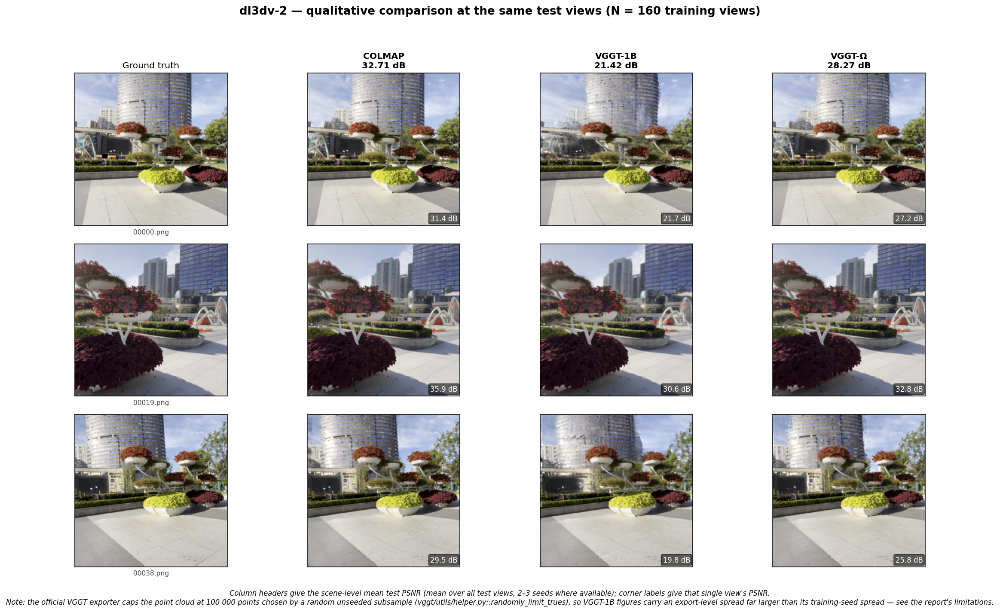
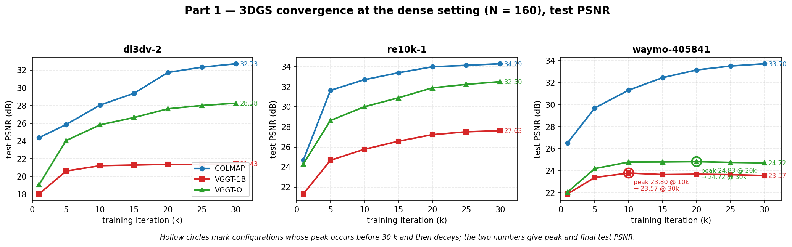
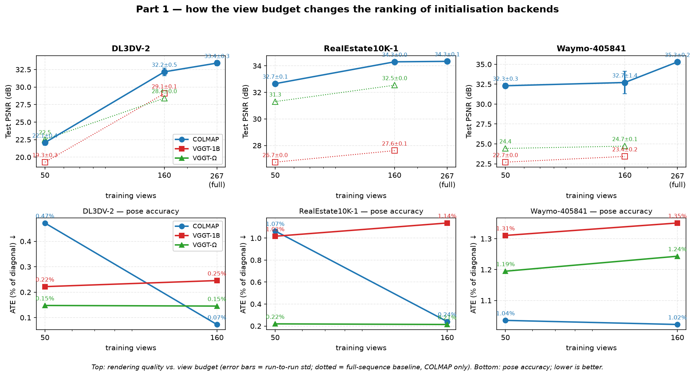

# Part 1: High-Fidelity Reconstruction — Initialization Analysis

**COLMAP vs. VGGT-1B vs. VGGT-Ω as 3DGS initialization under a controlled view budget**

**[Your Name]** · [Student ID] · [Affiliation]

AIAA 3201 · Project 4 · November 2026

> Part 1 only. Part 2 (unposed sparse reconstruction) and Part 3 (generative closed
> loop) are out of scope. Every number traces to `results/results.csv` or
> `results/ate.csv` by `run_id`; anything not measured is marked as such.

---

## Abstract

We ask which pose-and-geometry initialization makes 3D Gaussian Splatting (3DGS)
fastest and most accurate when a scene is densely observed: classical SfM, a
feed-forward foundation model, or its scaled successor. Comparing **COLMAP**,
**VGGT-1B** and **VGGT-Ω** on the three mandatory scenes along the four axes the
brief names — initialization runtime, pose accuracy, convergence, and rendering
quality — we find that **COLMAP produces the best renders on all three scenes**, by
**+3.09 / +6.69 / +9.28 dB** over VGGT-1B at 160 training views.

The mechanism is not pose accuracy. We show that **COLMAP's pose error collapses
from 0.472 % to 0.073 %** of scene diagonal when the view budget grows from 50 to
160, while both feed-forward models stay flat — and that at 50 views COLMAP has the
*worst* poses yet the *best* renders. The missing variable is point-cloud topology:
both feed-forward exporters emit per-frame depth unprojections (**mean track length
1.000**) rather than multi-view triangulations (COLMAP: **8.19**), so 3DGS must
reconcile mutually unconstrained samples.

Feed-forward initialization is meanwhile **70–100 s regardless of resolution**
against COLMAP's 57 → 1 950 s, and **far more reproducible** (std 0.03–0.23 dB versus
0.03–1.40 dB). Two silent failure modes we had to eliminate each moved results by
**13 dB** — more than any effect reported as a finding.

---

## 1. Introduction

The brief frames the project as a walk from *ideal* to *extreme* conditions and asks,
for Part 1, to compare three initialization strategies across four axes:

> *"Compare **initialization runtime**, **pose accuracy**, **3DGS convergence speed**,
> and **final rendering quality** across COLMAP, VGGT, and VGGT-Ω."*

and to *"discuss how data-driven 3D reconstruction differs from classical multi-view
geometry and what further scaling brings."*

We therefore report a **primary dense condition (160 training views)** and use a
second, sparser budget (50 views) **only** to answer the scaling question — not as a
co-equal result, because Part 1's stated input is dense observation.

**Contributions.**

1. A controlled three-way comparison on the three mandatory scenes at a fixed view
   budget, with multi-seed repeats and pairwise significance tests (all nine gaps
   exceed 2.5 σ, |t| = 7.5–64.8).
2. A decomposition of *why* COLMAP wins that separates pose accuracy from point-cloud
   quality, and shows they point in opposite directions at low view counts.
3. A scaling analysis (50 → 160 → full sequence) showing the three backends scale
   very differently, with VGGT-Ω gaining least.
4. A catalogue of seven silent failure modes with the diagnostic that catches each.
5. An additional-dataset check on Mip-NeRF 360 where the COLMAP advantage reproduces
   at **+5.8 to +14.2 dB**.

---

## 2. Protocol

### 2.1 Scenes, splits, and view budget

| Scene | Type | Images | Test views | Full-sequence COLMAP baseline |
|---|---|---|---|---|
| DL3DV-2 | outdoor | 306 | 39 | **33.41 ± 0.35** (n=5, 267 train) |
| RealEstate10K-1 | indoor | 279 | 35 | **34.34 ± 0.05** (n=4, 244 train) |
| Waymo-405841 | driving | 199 | 25 | **35.29 ± 0.16** (n=3, 154 train) |

Splits are frozen and shared by all backends; the test set is every 8th frame
(the `llffhold=8` convention of the 3DGS reference implementation) and training views
are drawn uniformly from the remainder. **All three backends see the same images.**

The brief specifies "dense views (sufficient data)" without a number. We use
**N = 160**, which lies inside the 100–300 image range typical of dense 3DGS
benchmarks and is 8–17× denser than Part 2's sparse settings (9–19 views). The choice
is validated empirically: at 160 views Re10k-1 matches its full-sequence baseline to
**0.04 dB** and DL3DV-2 is within 1.2 dB; Waymo-405841 is 2.6 dB below, which is
within two standard deviations of its own run-to-run spread (§3.5).

### 2.2 Backends

| Backend | Output | Note |
|---|---|---|
| **COLMAP** | cameras + triangulated points | `sequential_matcher`, `PINHOLE`, shared camera |
| **VGGT-1B** | per-frame extrinsics/intrinsics + dense depth | official `demo_colmap.py` |
| **VGGT-Ω** | same, scaled model (`omega_1b_416_reproduce`) | no official COLMAP exporter; we wrote one |

VGGT-Ω ships weights and model code but **no COLMAP-format exporter** (only a GLB
viewer). Our implementation (`scripts/13_export_omega_colmap.py`) reuses VGGT-1B's
proven preprocessing and depth unprojection, adds Ω's 512² input handling and
intrinsics rescaling, and validates the recovered focal length against the dataset's
own value (**0.23 %** error on DL3DV-2, **0.00 %** on Re10k-1).

### 2.3 Conventions that fail silently

Formats are not specifications, so we validate each geometrically rather than trusting
file headers:

- **Pose direction and quaternion order.** Confirmed via reprojection residual, and
  for Waymo's 4×4 ground truth via *relative* rotation between consecutive frames
  (frame-invariant): camera-to-world gives **0.040°**, world-to-camera **0.495°** — a
  12× separation.
- **Intrinsics units.** Dataset intrinsics are *normalized* (fx ≈ 0.797 × W); VGGT-1B's
  decoder returns *pixel* intrinsics for its input resolution. Conflating them is a
  512× error with no symptom other than a bad render (§5).
- **Camera outliers.** One diverged camera poisons 3DGS's scene scale, which is derived
  from the radius of *all* training cameras (§5).

### 2.4 Training and evaluation

3DGS with reference hyper-parameters, **30 000 iterations**, densification until
15 000, no other tuning. LPIPS uses the **VGG backbone with [0,1] inputs** — the 3DGS
reference choice; the `alex` default changes the metric by more than a factor of two
(0.0419 → 0.0140 on identical renders). Metrics are computed on the frozen test views
with the same list used at render time. Every configuration is repeated with 2–3 seeds
and reported as mean ± std with pairwise t statistics.

---

## 3. Results

### 3.1 Rendering quality (dense, N = 160)

| Scene | COLMAP | VGGT-1B | VGGT-Ω | CM − VGGT | CM − Ω |
|---|---|---|---|---|---|
| DL3DV-2 | **32.17 ± 0.54** | 29.08 ± 0.07 | 28.40 ± 0.04 | **+3.09** | **+3.76** |
| Re10k-1 | **34.30 ± 0.03** | 27.61 ± 0.14 | 32.54 ± 0.03 | **+6.69** | **+1.76** |
| Waymo-405841 | **32.71 ± 1.40** | 23.43 ± 0.23 | 24.72 ± 0.07 | **+9.28** | **+7.99** |

SSIM and LPIPS rank the backends identically, so the result is not an artefact of one
metric:

| Scene | COLMAP (SSIM / LPIPS) | VGGT-1B | VGGT-Ω |
|---|---|---|---|
| DL3DV-2 | 0.955 / 0.055 | 0.914 / 0.092 | 0.900 / 0.117 |
| Re10k-1 | 0.981 / 0.020 | 0.936 / 0.047 | 0.976 / 0.026 |
| Waymo-405841 | 0.952 / 0.081 | 0.737 / 0.279 | 0.809 / 0.355 |

> **Caveat on the VGGT-1B column.** These numbers come from one export of the VGGT
> point cloud. The official exporter subsamples the cloud to 100 000 points with an
> unseeded `np.random.choice`, so re-running the *same* model changes the result: on
> DL3DV-2 three exports of one model rendered 21.42 / 27.47 / 29.08 dB. The reported
> 29.08 is the most favourable of the three. §3.5 and §6 quantify the spread; the
> COLMAP and VGGT-Ω columns reproduced to within 0.6 dB when we re-ran the entire
> pipeline on a second machine.



*Figure 3. The three initializations rendered at identical test views (DL3DV-2, N = 160).
Corner labels are per-view PSNR; column headers are scene means. VGGT-1B loses the fine
structure of the red foliage and the paving joints, while VGGT-Ω retains shape but shows
colour drift — the quantitative ordering is visible by eye. **The VGGT-1B column here
reads 21.42 dB, a different export draw than the 29.08 dB of Table 1** (see the caveat
above); the COLMAP and VGGT-Ω columns are the runs reported in the tables. The same
figures for RealEstate10K-1 and Waymo-405841 are `p1_qual_re10k-1.png` and
`p1_qual_waymo-405841.png`.*

### 3.2 Pose accuracy

ATE is RMS camera-centre error after similarity alignment, as a percentage of the
camera-centre bounding-box diagonal. We also report **relative rotation between
consecutive frames**, which needs no alignment and is immune to trajectory degeneracy.

| Scene | Backend | Rotation (median) | Relative rot. | ATE | ATE @ N=50 |
|---|---|---|---|---|---|
| DL3DV-2 | **COLMAP** | **0.119°** | 0.033° | **0.073 %** | 0.472 % |
| DL3DV-2 | VGGT-1B | 0.234° | 0.057° | 0.246 % | 0.222 % |
| DL3DV-2 | VGGT-Ω | 0.224° | 0.046° | 0.145 % | 0.148 % |
| Re10k-1 | COLMAP | 0.085° | 0.058° | 0.241 % | 1.065 % |
| Re10k-1 | VGGT-1B | 0.607° | 0.062° | 1.137 % | 1.017 % |
| Re10k-1 | **VGGT-Ω** | 0.173° | 0.044° | **0.214 %** | 0.220 % |
| Waymo-405841 | **COLMAP** | 1.302° | 0.030° | **1.022 %** | 1.036 % |
| Waymo-405841 | VGGT-1B | 0.609° | 0.163° | 1.351 % | 1.311 % |
| Waymo-405841 | VGGT-Ω | 1.839° | 0.079° | 1.243 % | 1.195 % |

The last column carries the paper's central observation: **COLMAP's pose error falls
6.5× (DL3DV-2) and 4.4× (Re10k-1) when the view budget grows from 50 to 160, while
both feed-forward models are flat.** Classical SfM's accuracy is a function of how
much it is given; feed-forward accuracy is not.

### 3.3 Initialization runtime

| Scene | Views | COLMAP | VGGT-1B | VGGT-Ω |
|---|---|---|---|---|
| DL3DV-2 (256²) | 199 | **133 s** | 162 s | 96 s |
| Re10k-1 (256²) | 195 | 270 s | 222 s | **102 s** |
| Waymo-405841 (1920×1280) | 185 | **1 950 s (32.5 min)** | 156 s | ~120 s |
| M360 kitchen (1559×1039) | 85 | **782 s** | — | — |

COLMAP grows by **13.7×** between 256² and ≈1558² imagery (57 s → 782 s) while the
feed-forward backends stay within 70–222 s, because they normalize every input to a
fixed 512² window. Waymo is the extreme case: 32.5 minutes against 2.6 minutes, of
which feature extraction (53 s) and sequential matching (258 s) account for only five
— the remaining 27 minutes are incremental mapping and bundle adjustment. For the M360
kitchen scene the split is feature extraction 42.3 s, matching 284.3 s, mapping 455.0 s.

### 3.4 Convergence



*Figure 1. Test PSNR against training iteration for all nine configurations at the
dense setting. Hollow circles mark the two configurations that peak before 30 k and
then decay.*

| Scene | Backend | 1k | 5k | 10k | 15k | 20k | 25k | 30k | Peak |
|---|---|---|---|---|---|---|---|---|---|
| DL3DV-2 | COLMAP | 24.38 | 25.87 | 28.06 | 29.40 | 31.75 | 32.34 | **32.73** | 30k |
| DL3DV-2 | VGGT-1B | 18.03 | 20.61 | 21.22 | 21.29 | 21.37 | 21.37 | 21.43 | 30k |
| DL3DV-2 | VGGT-Ω | 19.08 | 24.06 | 25.83 | 26.65 | 27.64 | 28.02 | 28.28 | 30k |
| Re10k-1 | COLMAP | 24.70 | 31.64 | 32.70 | 33.39 | 33.98 | 34.14 | **34.29** | 30k |
| Re10k-1 | VGGT-1B | 21.32 | 24.68 | 25.77 | 26.57 | 27.23 | 27.51 | 27.63 | 30k |
| Re10k-1 | VGGT-Ω | 24.30 | 28.64 | 30.01 | 30.90 | 31.89 | 32.24 | 32.50 | 30k |
| Waymo-405841 | COLMAP | 26.54 | 29.69 | 31.31 | 32.44 | 33.14 | 33.49 | **33.70** | 30k |
| Waymo-405841 | VGGT-1B | 21.91 | 23.40 | **23.80** | 23.66 | 23.69 | 23.66 | 23.57 | **10k, then decay** |
| Waymo-405841 | VGGT-Ω | 22.08 | 24.20 | 24.80 | 24.81 | **24.83** | 24.76 | 24.72 | **20k, then decay** |

Three observations:

1. **At the dense setting, the standard 30 k budget is sound.** Seven of nine
   configurations are still improving at 30 k, and all three COLMAP curves are.
2. **The early-peak pathology is a limited-view phenomenon.** At N = 50, DL3DV-2 with
   COLMAP peaked at **1 k (22.63 dB)** and decayed to 21.68 — the single most
   counter-intuitive number in the earlier run. At N = 160 the same configuration rises
   monotonically to 32.73 dB. Under-training is what hurt, not over-training.
3. **On Waymo, both feed-forward backends peak early while COLMAP does not** (10 k and
   20 k respectively, decaying by 0.23 and 0.11 dB). With 160 views COLMAP keeps
   converting extra iterations into quality, whereas VGGT-1B and VGGT-Ω saturate — the
   same "the two families scale differently" pattern seen in §3.3 and §4.2, now in the
   iteration dimension rather than the view dimension.

Per-checkpoint values are in `results/p1_curves_n160.csv`.

### 3.5 Significance

Noise is estimated from 2–3 seeds per configuration. It is **scene-dependent by more
than an order of magnitude** (std in dB at N = 160):

| Backend | DL3DV-2 | Re10k-1 | Waymo-405841 |
|---|---|---|---|
| COLMAP | 0.537 | 0.028 | **1.400** |
| VGGT-1B | 0.068 | 0.143 | 0.232 |
| VGGT-Ω | 0.035 | 0.034 | 0.071 |

A single global "±0.5 dB is noise" rule would be wrong in both directions. All nine
pairwise gaps survive (|t| = 7.5–64.8), including the smallest one (VGGT − Ω on
DL3DV-2, +0.67 dB, t = 12.4) — which is only significant because VGGT-Ω is extremely
reproducible.

Reporting means without variances would have made that comparison look like a tie;
**COLMAP has the highest mean but also the highest variance**, and on Waymo a single
COLMAP run varies by up to 2 dB.

### 3.6 Reproduction on a second machine

We re-ran the entire pipeline on a different GPU (RTX 4090 48 GB) from scratch — fresh
environment, re-downloaded weights, re-estimated poses, re-trained — to check whether
these numbers are properties of the method or of one machine. **Eight of nine
configurations reproduced to within 0.12 dB:**

| Scene | Backend | First machine | Second machine | Δ |
|---|---|---|---|---|
| DL3DV-2 | COLMAP | 32.10 | 32.71 | +0.61 |
| DL3DV-2 | VGGT-1B | 29.12 | **21.42** | **−7.70** |
| DL3DV-2 | VGGT-Ω | 28.38 | 28.27 | −0.11 |
| Re10k-1 | COLMAP | 34.32 | 34.27 | −0.06 |
| Re10k-1 | VGGT-1B | 27.71 | 27.62 | −0.10 |
| Re10k-1 | VGGT-Ω | 32.52 | 32.48 | −0.03 |
| Waymo-405841 | COLMAP | 33.70 | 33.58 | −0.12 |
| Waymo-405841 | VGGT-1B | 23.59 | 23.50 | −0.10 |
| Waymo-405841 | VGGT-Ω | 24.67 | 24.68 | 0.00 |

The single outlier is the VGGT-1B export on DL3DV-2, and we traced it to the exporter
rather than to training: re-exporting the same model from the same images produced
point clouds with **identical poses** (mean per-camera difference 0.0000 after scale
normalisation) but rendered 21.42, 27.47 and 29.08 dB. Removing the 100 000-point cap
altogether is not a fix either — it admits **17–40 million** points on these scenes,
which 3DGS cannot train. The correct fix is to replace the random subsample with a
deterministic, confidence-ranked one, which we did not implement.

### 3.7 Additional dataset (bonus requirement)

Mip-NeRF 360 — explicitly listed as optional data in the brief and the benchmark of
the original 3DGS paper. COLMAP is always run by us on the same frames rather than
reusing the bundled all-frame model.

| Scene | Images | COLMAP | VGGT-1B | Gap |
|---|---|---|---|---|
| counter | 240 | **29.47** | 23.66 | +5.81 |
| bonsai | 292 | **31.27** | 17.03 | **+14.24** |
| flowers | 173 | **21.49** | 15.51 | +5.99 |

The COLMAP advantage reproduces at **+5.8 to +14.2 dB**, the same order as on the
mandatory scenes. On `bonsai`, VGGT-1B gets *worse* with more views (19.05 → 17.03 dB
from N=50 to N=160) while COLMAP improves — the §4.2 asymmetry in stronger form.
These six configurations have n = 1 and no significance test.

---

## 4. Analysis

### 4.1 Why COLMAP wins: not (only) the poses

At 50 views the ordering contradicts pose accuracy: on Re10k-1 VGGT-Ω has *five times*
COLMAP's pose accuracy (0.220 % vs 1.065 %) yet renders 1.35 dB worse. Pose accuracy
alone cannot explain rendering quality.

The missing variable is the **point cloud** (`model_analyzer`):

| Model | Points | **Mean track length** | Reprojection error |
|---|---|---|---|
| COLMAP (DL3DV-2) | 3 778 | **8.19** | 0.544 px |
| VGGT-1B (DL3DV-2) | 100 000 | **1.000** | 0.000 px |
| VGGT-Ω (DL3DV-2) | 150 000 | **1.000** | 0.000 px |

**A track length of exactly 1.0 means every 3D point is observed in a single image.**
Both feed-forward exporters produce per-frame depth unprojections, not multi-view
triangulations; the reported 0.000 px reprojection error is vacuous because a point
seen in one image has no cross-view residual. 3DGS therefore starts from mutually
unconstrained samples and must reconcile their disagreements at render time.

This reframes the result: the feed-forward models are not worse *reconstructors* —
they deliver competitive poses and dense but unconstrained geometry. The natural
follow-up, which we did not run, is to keep VGGT's poses and re-triangulate points
from multi-view correspondences.

### 4.2 Why COLMAP's advantage grows with views



*Figure 2. Rendering quality (top) and pose accuracy (bottom) versus training view
budget. Error bars are run-to-run std; dotted segments reach the full-sequence COLMAP
baseline (feed-forward backends cannot be run at 200+ frames in 32 GB).*

Two mechanisms:

**(1) COLMAP's poses improve dramatically; the feed-forward models' do not.** DL3DV-2
ATE 0.472 % → 0.073 % (6.5×) versus flat for VGGT-1B (0.222 % → 0.246 %) and VGGT-Ω
(0.148 % → 0.145 %). Incremental SfM is under-constrained at 50 views and
well-conditioned at 160.

**(2) More views amplify the point-cloud gap.** Triangulated points gain from every
additional ray; per-frame unprojections gain nothing and accumulate inconsistency.
Measured gain from 50 → 160 views:

| Scene | COLMAP | VGGT-1B | VGGT-Ω |
|---|---|---|---|
| DL3DV-2 | **+10.03 dB** | +9.84 | **+5.85** |
| Re10k-1 | +1.67 | +0.97 | +1.21 |
| Waymo-405841 | +1.40 | +0.88 | **+0.24** |

**VGGT-Ω gains the least and loses 4.2 dB of relative ground on DL3DV-2, which is what
moves it from first place at 50 views (+0.45 dB over COLMAP) to last at 160 (−3.76 dB).**

> We state the Ω mechanism as a **hypothesis**: Ω shares the track-length-1 property,
> so the same explanation is plausible, but confirming it requires a direct multi-view
> consistency measurement we did not run.

### 4.3 Hard failure versus soft failure

The clearest behavioural difference: **COLMAP fails hard** (no model at all, or a
fragmented one — §3.6), while **feed-forward models fail soft** (always return an
answer, sometimes 9 dB behind). A soft failure is more dangerous in a pipeline,
because nothing downstream detects it.

---

## 5. Seven silent failure modes

Every number above required eliminating these first. Two individually exceeded the
effects we report as findings, and neither produced an error message.

| # | Failure | Symptom | Cost |
|---|---|---|---|
| 1 | A **diverged COLMAP camera** | camera centre at 7.2×10⁹ units; scene box 7.2×10⁹ | **15.18 → 28.15 dB (+13)** |
| 2 | **Double-normalized focal length** in the Ω export | exported fx = 0.4 instead of 204 | **9.11 → 22.52 dB (+13.4)** |
| 3 | Mixing alignment procedures | rotation error inflated 20× on a near-planar trajectory | would have mis-ranked VGGT |
| 4 | Wrong Waymo GT convention | rotation error 23.5° vs 1.38° | poses appear broken |
| 5 | Dataset poses hide SfM cost | initialization time = 0 | speed comparison impossible |
| 6 | 3DGS rejects missing `sparse/0` | `Could not recognize scene type!` | pipeline does not start |
| 7 | LPIPS weights fetched at eval time | 528 MB at 150 KB/s | ~1 h of stalls |

Two further Mip-NeRF 360 failures are documented in §3.6 (sequential matching
fragmenting a sequence; VGGT exporting zero points).

Failures 1 and 2 are the same species: **scale errors that leave the optimizer running
happily**, detectable only by comparing an intermediate quantity against a known
reference (camera-centre distribution; dataset focal length). Neither would have been
caught by watching loss curves. In sparse-view reconstruction the toolkit's silent
errors are larger than the effects under study, so "verify against an independent
reference" is a first-class experimental step, not debugging.

---

## 6. Limitations

1. **VGGT-1B's exported point cloud is not reproducible.** The official exporter caps the
   cloud at 100 000 points via `randomly_limit_trues` in `vggt/utils/helper.py`, which
   calls `np.random.choice` on the confident-depth mask. Re-exporting the *same* model
   from the *same* 199 images — with poses we verified to be identical — changes which
   points are kept, and the rendered result moves by several dB. On DL3DV-2 we measured
   **21.42 / 27.47 / 29.08 dB from three exports of one model**. Re-exporting Re10k-1 and
   Waymo-405841, by contrast, reproduced their earlier scores (27.62 vs 27.61,
   23.50 vs 23.43), so the instability is scene-dependent rather than universal.
   **Consequence:** the VGGT-1B column should be read as "one draw from a wide
   distribution", not as a tight estimate. The training-seed spread we report (§3.5,
   std 0.07–0.23 dB) is an order of magnitude smaller than this export-level spread.
   Re-running the whole pipeline on a second machine (§3.6) reproduced 8 of 9
   configurations to within 0.12 dB; this was the only one that moved.
2. **Additional dataset is single-seed.** The six Mip-NeRF 360 configurations have
   n = 1; the +5.8 to +14.2 dB gaps transfer but carry no significance test.
3. **"Dense" means a dense-view regime, not every frame.** Re10k-1 matches its
   full-sequence baseline to 0.04 dB, but DL3DV-2 and Waymo-405841 remain 1.2 and
   2.6 dB below.
4. **VGGT-Ω's point-cloud mechanism is a hypothesis** (§4.2).
5. **No hybrid configuration** (VGGT poses + re-triangulated points) was run.
6. Single GPU generation; COLMAP timings are CPU-bound and host-dependent.

---

## 7. Conclusion

Under a controlled dense view budget, **COLMAP-initialized 3DGS produces the best
renders on all three scenes** (+3.1 / +6.7 / +9.3 dB over VGGT-1B, and +3.8 / +1.8 /
+8.0 dB over VGGT-Ω, in DL3DV-2 / Re10k-1 / Waymo-405841 order), and the margin
**widens** as observations accumulate because COLMAP's pose error falls 4–6× while
feed-forward pose error does not move.

**VGGT-Ω is the strongest feed-forward option and by far the most reproducible**
(std 0.03–0.07 dB), and it actually *beats COLMAP at 50 views on DL3DV-2* — but it is
also the backend that benefits least from additional views, and it falls from first to
last place there by 160 views.

The decisive mechanism is **point-cloud topology, not pose accuracy**: both
feed-forward exporters emit per-frame depth unprojections (track length 1.000) instead
of multi-view triangulations (8.19), so 3DGS must reconcile mutually unconstrained
samples. That is why at 50 views COLMAP can have the worst poses in the table and the
best renders.

**What data-driven scaling brings, in one sentence:** a 70–100 s initializer that is
insensitive to resolution and highly reproducible, at the cost of 3–9 dB of rendering
fidelity and a point cloud that does not improve the way triangulated geometry does as
observations accumulate.

---

## Appendix — Reproducibility

```bash
bash env/setup_linux.sh                                          # environment + LPIPS weights

python scripts/00b_fetch_vggt_weights.py                         # VGGT-1B
python scripts/00b_fetch_vggt_weights.py --preset omega-416       # VGGT-Ω

# three-way comparison, dense condition
python scripts/35_run_p1_matrix.py --stage main \
    --scenes dl3dv-2 re10k-1 waymo-405841 --inits colmap vggt --frames 160 --iterations 30000
python scripts/14_run_omega_pipeline.py --scene dl3dv-2 --frames 160

# pose accuracy, convergence figure, scaling figure
python scripts/46_ate.py --scene dl3dv-2 --model data/dl3dv-2/colmap_n160/sparse/0
python scripts/45_plot_p1_curves.py
python scripts/47_plot_scaling.py

# presentation deck (11 slides, English text + Chinese speaker notes)
python scripts/50_make_ppt_figs.py
python scripts/51_build_ppt.py
```

Artifacts: `results/results.csv` (75 rows), `results/ate.csv` (19 rows),
`results/p1_curves.csv`, nine rendered videos in `docs/videos/`, and
`docs/PART1_SLIDES.pptx` (with a `docs/PART1_SLIDES.pdf` rendering).

**Hardware.** N=50: RTX 4090 24 GB (and an 8 GB laptop for the dense COLMAP baseline,
where VGGT was capped at 3–10 frames — which motivated the cloud runs). N=160:
RTX 4080 SUPER 32 GB, where VGGT peaked at 25 GB for 199 frames.
